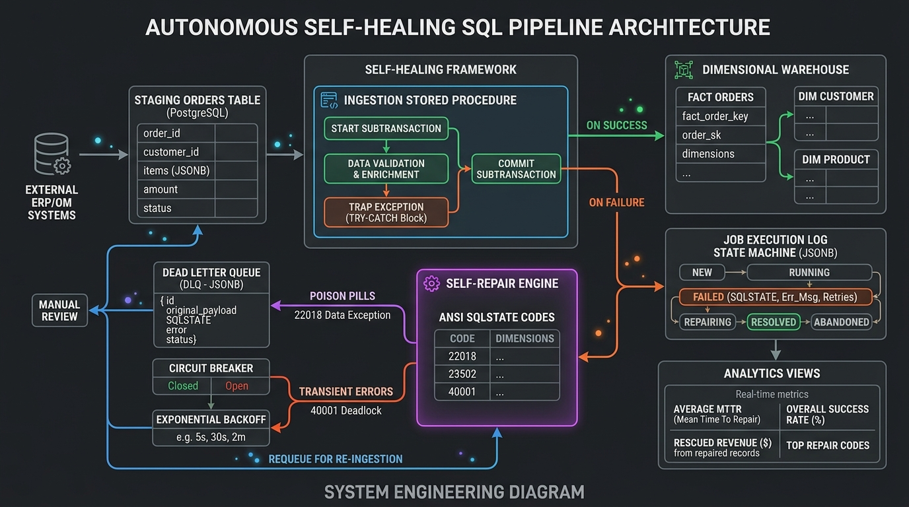

# Autonomous Self-Healing SQL Pipeline

An enterprise-grade, self-healing data ingestion engine built natively in PostgreSQL with background Python orchestration and observability. Designed to automatically trap transactional failures, classify ANSI SQLSTATE error codes, quarantine poison-pill records into a Dead-Letter Queue (DLQ), and self-repair batches with zero human intervention.



---

## 📁 Repository Structure

```plaintext
autonomous-sql-pipeline/
│
├── sql/
│   ├── 01_schema_init.sql         # DDL: Extensions, Enums, Dim, Fact, Staging & DLQ tables  
│   ├── 02_ingestion_proc.sql      # Stored Procedure: Ingestion logic with EXCEPTION trapping
│   ├── 03_repair_engine.sql       # Stored Procedure: Diagnostic repair engine & ANSI matrix
│   └── 04_analytics_views.sql     # Analytics Views: MTTR, Success Rate, Rescued Revenue
│
├── daemon/
│   ├── scheduler_daemon.py        # Background orchestrator (cadence runner & watchdog)
│   └── chaos_injector.py          # Synthetic fault & poison-pill injector
│
├── docs/
│   └── architecture_diagram.png   # System workflow diagram
│
├── .gitignore                     # Git ignore rules for Python, DB logs, and OS artifacts
├── requirements.txt               # Python package dependencies
└── README.md                      # System documentation & deployment runbook
```

---

## 🏗️ Architecture & Core Components

### 1. State Machine & Execution Ledger (`sql/01_schema_init.sql`)
- **`job_status` ENUM**: `PENDING`, `RUNNING`, `SUCCESS`, `FAILED`, `REPAIRING`, `QUARANTINED`.
- **`job_execution_log`**: An immutable audit ledger tracking batch UUIDs, status transitions, retry counts, ANSI error codes, error messages, and retry backoff windows.
- **Dimensional Model**: Master dimension tables (`dim_customers`, `dim_products`) and core warehouse target (`fact_orders`).
- **Ingestion Staging**: Raw, unvalidated landing table (`staging_orders`).
- **Dead-Letter Queue (`dead_letter_quarantine`)**: Captures corrupted rows with original payloads preserved as `JSONB` alongside specific rejection reasons.

### 2. Autonomous Ingestion Procedure (`sql/02_ingestion_proc.sql`)
- **Procedure**: `run_order_ingestion(p_job_name TEXT)`
- **Isolated Subtransactions**: Wraps the ELT step in an isolated `BEGIN ... EXCEPTION` subtransaction block.
- **Idempotent Upsert**: Utilizes `ON CONFLICT (order_id) DO UPDATE` to guarantee exactly-once processing during partial retries.
- **Error Trapping**: Intercepts check violations, foreign key errors, not-null failures, and deadlocks. Captures `SQLSTATE` and `SQLERRM` into the execution log while scheduling an automated 30-second backoff window.
- **Staging Hygiene**: Automatically executes `TRUNCATE staging_orders` on successful transfer.

### 3. Diagnostic Self-Repair Engine (`sql/03_repair_engine.sql`)
- **Procedure**: `run_self_repair_engine()`
- **Circuit Breaker**: Halts re-execution and marks batches as `QUARANTINED` if attempts exceed `max_retries` (default: 3).
- **ANSI SQLSTATE Diagnostic Matrix**:
  - **Playbook A (Integrity & Constraint Violations — `23502`, `23514`, `23503`)**: Employs a Common Table Expression (CTE) to surgically purge poison records from `staging_orders` into `dead_letter_quarantine` as JSONB. Re-queues the clean records to `PENDING` for immediate ingestion.
  - **Playbook B (Transient Locks & Concurrency — `40001`, `40P01`, `57014`)**: Applies exponential backoff ($2^{\text{attempt}} \times 15\text{s}$) to gracefully wait out lock contention.
  - **Playbook C (Unhandled / Structural Anomalies)**: Flags anomalous executions as `QUARANTINED` for administrative inspection.

### 4. SRE & Financial Analytics Views (`sql/04_analytics_views.sql`)
- **`vw_pipeline_health_metrics`**: Calculates total failures, Mean Time to Repair (MTTR in seconds), maximum latency, and overall pipeline success rate percentage.
- **`vw_pipeline_financial_impact`**: Separates processed revenue into First-Pass Revenue, Auto-Healed Rescued Revenue, and Quarantined At-Risk Revenue.
- **`vw_error_code_distribution`**: Pareto distribution of ANSI SQLSTATE errors observed across the system.

### 5. Orchestration & Chaos Testing Daemons (`daemon/`)
- **`scheduler_daemon.py`**: Background orchestrator invoking `run_self_repair_engine()` every 10 seconds and `run_order_ingestion()` every 20 seconds.
- **`chaos_injector.py`**: Synthetic fault injector staging randomized batches containing clean records, foreign key mismatches, and negative quantity checks.

---

## 🚀 Quickstart & Deployment Runbook

### Step 1: Install Python Dependencies
```bash
python -m venv venv
# On Windows:
venv\Scripts\activate
# On Linux/macOS:
source venv/bin/activate

pip install -r requirements.txt
```

### Step 2: Initialize Database Schema & Procedures
Connect to your PostgreSQL database (e.g. `self_repair_db`) and execute the SQL scripts in order:

```bash
psql -U postgres -d self_repair_db -f sql/01_schema_init.sql
psql -U postgres -d self_repair_db -f sql/02_ingestion_proc.sql
psql -U postgres -d self_repair_db -f sql/03_repair_engine.sql
psql -U postgres -d self_repair_db -f sql/04_analytics_views.sql
```

### Step 3: Run the Autonomous Scheduler Daemon
In terminal 1, launch the scheduler:
```bash
python daemon/scheduler_daemon.py
```

### Step 4: Inject Chaos & Test Self-Healing
In terminal 2, run the chaos generator:
```bash
python daemon/chaos_injector.py
```

---

## 🔍 Observability & Monitoring Queries

### 1. Inspect Pipeline Reliability & MTTR
```sql
SELECT * FROM vw_pipeline_health_metrics;
```

### 2. Inspect Commercial & Rescued Revenue Impact
```sql
SELECT * FROM vw_pipeline_financial_impact;
```

### 3. Inspect Error Code Breakdown (Pareto Analysis)
```sql
SELECT * FROM vw_error_code_distribution;
```

### 4. Review Dead-Letter Quarantine (DLQ)
```sql
SELECT quarantine_id, source_table, raw_record, rejection_reason, quarantined_at 
FROM dead_letter_quarantine 
ORDER BY quarantined_at DESC LIMIT 10;
```
